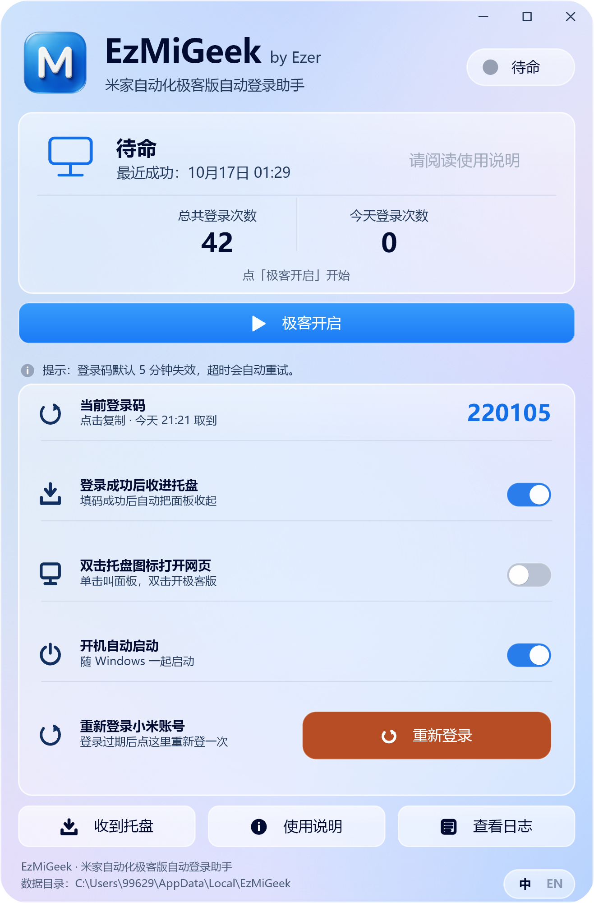

# EzMiGeek

米家自动化极客版自动登录工具，提供 **桌面版（Windows / macOS，无需扩展）** 与 **浏览器篡改猴脚本** 双形态。

<p align="center">
  
</p>

| | 桌面版（Windows / macOS） | 篡改猴脚本版 |
|---|---|---|
| 形态 | 绿色独立程序（Flutter Desktop） | 浏览器 Userscript |
| 安装 | 下载 [GitHub Release](https://github.com/Ezer521/EzMiGeek/releases/latest) 解压即用 | 安装篡改猴后[点此一键安装](https://github.com/Ezer521/EzMiGeek/releases/latest/download/EzMiGeek-script.user.js) |
| 自动更新 | 托盘右键 →「检查更新」 | 支持 Tampermonkey 自动更新 |
| 适合 | 独立应用、系统托盘常驻、开机自启、免扩展 | 常开浏览器、轻量零安装 |

核心能力：打开米家极客版网页自动取码并填入，无需抓包、无需手机扫码；自动识别路由器自带中枢（`8086` 端口）与独立中枢网关（`80` 端口）；换中枢硬件自动发现；断连自动补码重连；登录态过期一键重登。

---

## 一、桌面版（Windows & macOS）

### 直接下载使用

1. 前往 [Releases](https://github.com/Ezer521/EzMiGeek/releases/latest) 下载对应系统的压缩包：
   - **Windows (x64)**：`EzMiGeek-win64-v*.zip`，解压后双击 `EzMiGeek.exe`
   - **macOS (Apple Silicon / macOS 12+)**：`EzMiGeek-macos-arm64-v*.zip`，解压后将 `EzMiGeek.app` 拖入「应用程序」
2. 每次正式版均由 **GitHub Actions 从本仓库公开源码自动构建**，Release 页面附带统一的 `SHA256SUMS.txt` 校验值与构建溯源证明。
3. **首次运行提示**：
   - **Windows SmartScreen**：因未购买商业代码签名证书，首次运行可能弹出蓝底提示，核对 SHA256 后点「更多信息」→「仍要运行」；若精简系统缺失 `VCRUNTIME140.dll`，请安装微软 [Visual C++ Redistributable (x64)](https://aka.ms/vs/17/release/vc_redist.x64.exe)。
   - **macOS Gatekeeper**：因未购买 Apple 开发者公证，首次打开如提示「已损坏，无法打开」或「无法验证开发者」，在终端执行一次移除隔离属性命令即可正常打开：
     ```bash
     xattr -cr /Applications/EzMiGeek.app
     ```
     在 macOS 15 (Sequoia) 上首次扫描局域网中枢时，系统会弹出「本地网络」访问权限询问，点击「允许」即可。

### 手动指定中枢 IP（极客版不在默认网关上时）

程序默认按「缓存 → 默认网关 → 本网段扫描 → 小米云 `localip` 提示」自动发现中枢，自动探测 `8086` 和 `80` 端口并校验网页标题（「米家自动化极客版」），避免误认路由器管理页。

如果你的极客版跑在其他主机上（例如网关 `192.168.5.1`、中枢 `192.168.5.3`），支持两种指定方式：

- **启动参数**：`--hub 192.168.5.3` 或 `--hub 192.168.5.3:80`
- **配置文件**：编辑用户数据目录下的 `settings.json`（Windows：`%LOCALAPPDATA%\EzMiGeek\settings.json`；macOS：`~/Library/Application Support/EzMiGeek/settings.json`），设置 `"HubIp": "192.168.5.3"`（省略端口时按 `8086 → 80` 自动探测；留空恢复自动发现；每轮开跑自动热重载）

### 高级配置项（`settings.json`）

- `WaitMin`（1~60）/ `RetrySec`（1~60）/ `FailMax`（1~9）：取码超时分钟数、重试间隔秒数、连续失败转人工次数（每轮热重载）
- `AutoFullscreen`（默认 `true`）：打开极客版网页时是否全屏（设为 `false` 改为最大化，每轮热重载）
- `LocalCodeService`（默认 `true`）：是否开启本地回环取码 IPC 服务（详见下方说明，修改后重启生效）

### 本地回环取码服务（`CodeService`）透明说明

为方便本机其他工具复用已登录的小米取码能力，桌面版默认在 **仅限本机回环地址 `127.0.0.1` 的随机端口** 启动一个轻量 HTTP IPC 服务，并将端口号与一次性 64 位随机 `token` 写入用户数据目录的 `ipc.json`（退出时自动清理）：

- 仅监听 `127.0.0.1`，不对外网或局域网暴露，不触发防火墙弹窗；
- 仅接受 `GET` 请求，校验回环 `Host` 头与 `Authorization: Bearer <token>`（同时兼容 `?token=` 参数）；
- 若不需要该功能，可在 `settings.json` 中将 `"LocalCodeService": false` 并重启程序彻底关闭。

### 从源码自行构建

需要：Flutter SDK（Dart `>=3.8.0 <4.0.0`），Windows 需 Visual Studio C++ 桌面开发工具，macOS 需 Xcode 与 CocoaPods。

```bash
flutter pub get
flutter analyze
flutter test

# Windows 构建
flutter build windows --release

# macOS 构建
flutter build macos --release
```

---

## 二、篡改猴脚本版

源码位于 [`userscript/米家极客版-自动登录.user.js`](userscript/米家极客版-自动登录.user.js)。

1. 在 Chrome / Edge 中安装 [篡改猴 (Tampermonkey)](https://www.tampermonkey.net/) 扩展；
2. 点击直链安装：[安装 EzMiGeek-script.user.js](https://github.com/Ezer521/EzMiGeek/releases/latest/download/EzMiGeek-script.user.js)（或将 `.user.js` 拖入篡改猴面板安装）；
3. 打开米家极客版网页，自动取码填入（平时仅在右下角保留淡色小圆点，点击/悬停小圆点或按 `Ctrl+Alt+L` 可展开控制面板）。

---

## 隐私与安全

- 源码与发行包均不含任何预置账号凭据；
- 桌面版凭据仅加密存放在本机：Windows 使用 **DPAPI**（`%LOCALAPPDATA%\EzMiGeek\config.json`），macOS 存入系统登录 **Keychain**（`~/Library/Application Support/EzMiGeek/config.json` 仅存指针）；
- 桌面版使用独立浏览器 profile，不读取、不修改你日常浏览器的书签与登录态；
- 连接小米官方 HTTPS 接口严格校验 TLS 证书链（Windows 若缺失中间 CA 仅对小米官方白名单域调用原生 CryptoAPI 做系统级 AIA 补链与主机名校验；macOS 直接走系统严格 TLS 校验），拒绝任何不受信任或自签名证书；
- 自动运行期间所有请求仅发往小米官方接口与本机局域网中枢，不经过第三方服务器、不采集上传任何数据；仅在用户主动点击托盘「检查更新」时访问 GitHub Releases API；
- 日志文件不记录 6 位登录码明文、Cookie 或 Token 值。安全问题上报详见 [SECURITY.md](SECURITY.md)。

## 免责声明

非小米官方产品，与小米公司、米家及其关联公司无任何关系，未经其授权或背书。
本工具仅在你的本机使用你自己的小米账号运行，自动化逻辑可能因官方页面或协议调整失效，不承诺可用性，使用风险自负。
安装或继续使用即表示已阅读并接受以上内容。

## 作者与许可证

作者：`|Ezer|` · 变更记录见 [CHANGELOG.md](CHANGELOG.md) · 开源协议：[MIT](LICENSE)
